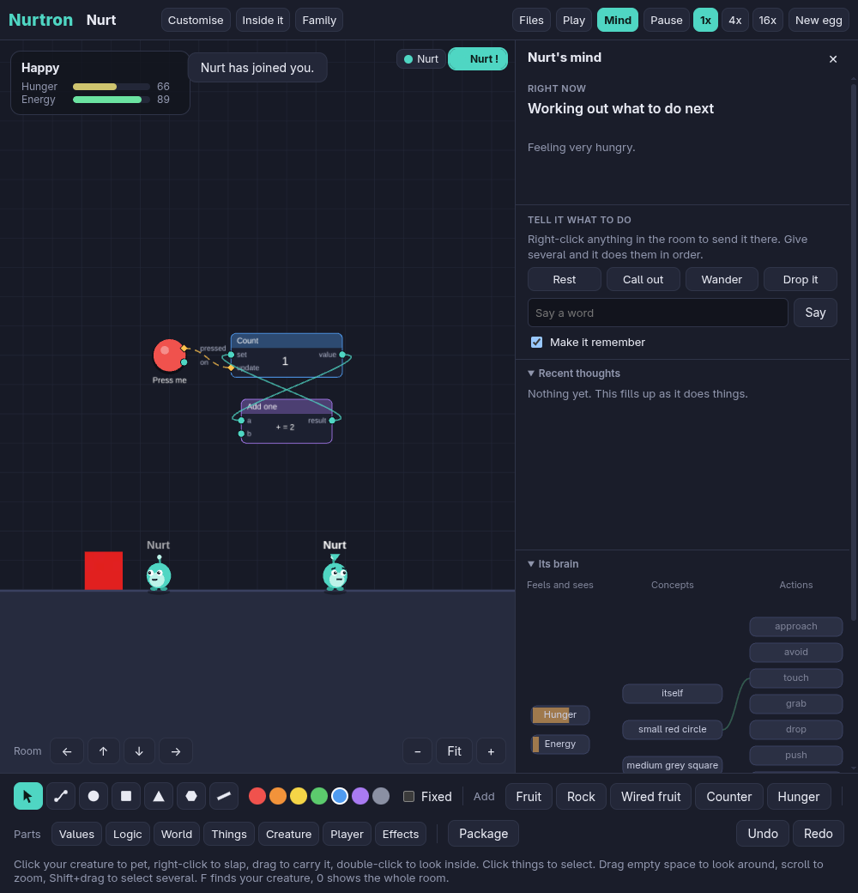

# Nurtron

> [!WARNING]
> **This game is vibe coded and early.** It was built mostly by chatting with an AI coding assistant, not written
> line by line by an experienced developer. Expect rough edges and bugs. There's no tutorial yet and no download yet,
> so you run it from source for now. It's mostly been used on Linux, and the Windows build is barely tested.

**You wire up a living creature's body, then raise what you've made.**

Nurtron is a 2D physics sandbox where the creatures have real little brains. Nothing they do is scripted: they learn from what happens to them, and from being petted or slapped. Build a hunger system out of a timer and some maths, make a fruit that feeds it, and soon your creature heads for the fruit because it learned to. Then send that creature to a friend as a file, and it still knows what you taught it.

In most creature games, the designers decide what a creature's body and needs are. Here you do. Want one that gets lonely, loves disco or is scared of the colour blue? Wire it up.



## What's in it

- **Creatures that learn from a handful of experiences**, with a brain small enough to watch working. It shows what they're doing, why, and what they've learned, in plain words.
- **Bodies made of real wires.** Hunger, energy and everything else are circuits you can open up and change. Choose ready-made stats, or wire your own.
- **A physics sandbox.** Build with shapes, ramps, motors and sensors. Rooms can be huge, and gravity can change from place to place, with zero-gravity zones where creatures walk on the air.
- **Families.** Genes, babies, siblings who act differently, and family trees.
- **Sharing as plain files.** Creatures, rooms, worlds, tools and Trials are all files that only hold data, so a file from a stranger can't run anything on your PC.
- **Words and Trials.** Teach a creature to come when called, or send a friend a room built to test their creature.
- **The start of a game engine.** Keyboard, Mouse, Spawner, Collision, Camera, Sound and more, plus a Play mode that hides the editor so what you built runs as a game.

## Playing it

You need [Node.js](https://nodejs.org) 22.18 or newer.

```bash
git clone https://github.com/ForsakenBlank/Nurtron.git
cd Nurtron
npm install
npm start
```

- **Click your creature** to pet it, **right-click** to slap it, **drag** to carry it. A pet or a slap teaches it about what it did in the last few seconds.
- **Pick a shape** from the bottom bar, then click to place it or drag to size it. Drag a plank from end to end to make a ramp.
- **Click things** to select and drag them, **right-click** for properties, **R** to rotate. **Ctrl+Z** undoes anything.
- **Pick a part** from the bottom bar, then **drag from one of its ports** to another to wire them up. **Right-click** a wire to remove it. **Add: Counter** and **Hunger** drop in ready-made circuits to pull apart.
- **Make it food:** hover near a shape to find its Touched output, then drag that onto a **Give** part set to Hunger with a number below zero. **Add: Wired fruit** drops in a ready-made one. Hunger at 100 means starving.
- **Choose its stats:** New egg and the Family panel let you pick from Hunger, Energy, Thirst, Health, Dies at 0 Health, Happiness and Loneliness.
- **Double-click your creature** to look inside. Its stats are real wires you can change, and any value plugged into a **Drive socket** becomes something it cares about.
- **Customise**, next to its name, changes its skin and colours.
- **Tell it what to do:** right-click a shape to send it there. Give several orders and it does them in order, and learns from them.
- **Files**, at the top, saves and opens creatures, rooms and worlds, and sets the **Room size**. You can also drag a file onto the window.
- **Pictures:** drag an image onto a shape. A creature sees the colour it mostly is.
- **Package:** select some parts and press **G** to make your own reusable tool.
- **Die** is a part like any other. Nothing dies unless you wire it up, like an Age that reaches a random number, or poison. **Revive** brings it back, and it remembers what went wrong.
- **Say** a word in the mind panel while it does something, and pet it. It can learn to come when called.
- **Trials:** Files saves a room with a Goal part as a Trial for a friend's creature, and opens theirs. Your own room comes back after.
- **Gravity:** World settings sets the gravity everywhere, and a Gravity zone part sets its own. With none, creatures float-walk.
- **Play** runs what you've built as a game, with the editor out of the way. Esc stops and puts it all back.
- **Family** shows what a creature is like and its relatives, and is where two grown-ups can have a baby.
- **Drag empty space** to look around, **scroll** to zoom, **Shift+drag** to select several, **F** to find your creature, **0** to see the whole room.
- **The Room arrows** at the bottom left of the map add more space on any side, any time. **World settings** in Files can set an exact size.
- **Tab** or **Mind** shows and hides what it's thinking. Drag the panel's edge to resize it.
- **Space** pauses, and **1**, **2** and **3** set the speed.
- Hover over anything to see what it has learned about that thing.

It saves by itself. Your creatures are still there when you come back, and the world stops while the game is closed.

### More detail

The building controls are in [docs/milestone-1.md](docs/milestone-1.md), wiring is in [docs/milestone-2.md](docs/milestone-2.md), bodies are in [docs/milestone-3.md](docs/milestone-3.md), files and tools are in [docs/milestone-4.md](docs/milestone-4.md), families, orders and getting around are in [docs/milestone-5.md](docs/milestone-5.md), and words, Trials, gravity and the game-making parts are in [docs/milestone-6.md](docs/milestone-6.md).

## Commands

| Command | What it does |
|---|---|
| `npm start` | Build and open the desktop app |
| `npm run dev` | The desktop app, reloading as you change the code |
| `npm run web` | The game in a browser at `localhost:5183` |
| `npm run bar` | Raise 100 creatures with no window and print whether they learn (about a minute) |
| `npx vitest run tests/first-minutes` | Play through the plan's first 10 minutes on 20 creatures |
| `npm run life` | Let one creature live alone for an hour and print how it spent its time |
| `npm test` | All the tests, including the learning bar on creatures never used for tuning |
| `npm run check` | Check the types |
| `npm run check-env` | Prove the tools, graphics, physics and desktop app all work on this PC. Opens a window for a few seconds |
| `npm run build-linux` | Build the app into `release/Nurtron-linux-x64` |
| `./install-linux.sh` | After that build, add it to your app launcher |
| `npm run build-win` | Build the Windows app into `release/Nurtron-win32-x64` |

## How it's built

TypeScript, with Rapier for physics, PixiJS for the room, Electron for the desktop app, and Vite to bundle it.

```
src/sim/    the simulation. no graphics at all, so tests can run it thousands of times faster than real time
  brain.ts          the brain: concepts, links, learning
  senses.ts         how it sees things: what they're like, never their names
  shapes.ts         the geometry of things
  physics.ts        the Rapier physics world
  world.ts          the room, its body, its actions, saving
  parts.ts          the circuit parts: their ports and settings
  circuit.ts        running the wires, and stopping loops
  look.ts           skins and colours
  examples.ts       the ready-made circuits
  edits.ts          undo and redo
  room-file.ts      saving and safely opening room files
  creature-file.ts  .nurt files: one creature, safely opened
  world-file.ts     a room and everyone in it
  trial-file.ts     a room built to test a creature
  navigate.ts       working out how to jump and climb to something
  packager.ts       turning a selection into a tool
  textures.ts       pictures on shapes, checked to really be pictures
  family.ts         genes, babies, growing up, family trees
  learning-bar.ts   the make-or-break test
src/app/    the game window
  scene.ts          drawing the room
  circuit-view.ts   drawing parts, wires and pulses
  nurt-art.ts       drawing a creature in any skin
  customise.ts      the skins and colours panel
  editor.ts         the mouse and keyboard: tools, selecting, rotating
  properties.ts     the right-click panel
  package-panel.ts  naming a tool and choosing its sockets
  family-panel.ts   who it is, its relatives, having babies
  thoughts.ts       what it has been thinking, in plain words
  pictures.ts       shrinking an image for a shape
  brain-view.ts     the live picture of its brain
electron/   the desktop shell
tests/      automated tests
docs/       notes on each milestone
```

See [docs/milestone-6.md](docs/milestone-6.md) for where things stand. There are no accounts, no servers and no online AI: it all runs on your own PC.
